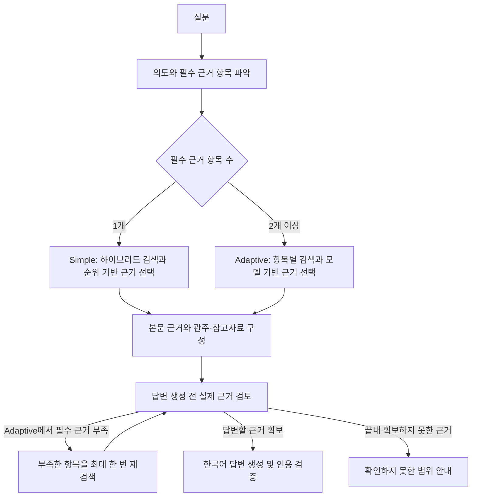

# BibleOn RAG

성경에 관한 자연어 질문에서 관련 본문을 찾고, 확인한 근거로 답변하는 Python RAG 시스템이다. `lookup`은 외부 API 없이 장절을 조회한다. 모델 답변을 생성하는 `ask`는 질문에 맞는 근거를 찾고 인용을 확인하는 17개 노드의 LangGraph를 사용한다.

## 처리 흐름

다음 도식은 `ask --profile auto`의 검색·답변 경로를 요약한 것이다. 단순 장절 조회는 별도의 `lookup` 명령으로 실행할 수 있다.



`auto`는 모델로 질문 의도와 필요한 근거를 파악한 뒤, 필수 근거 항목 수로 경로를 정한다. 두 경로 모두 답변을 생성하기 전에 실제 근거를 검토한다. Simple은 근거가 부족해도 Adaptive로 전환하거나 재검색하지 않는다. 일부만 확인할 수 있다면 확인된 범위와 나머지 한계를 구분하고, 핵심 근거가 없으면 답변 생성을 생략할 수 있다.

## 핵심 구현

| 구성 | 동작 | 파일 |
|---|---|---|
| 청킹 | 새번역 소제목의 절 좌표와 장 경계로 개역한글을 나눈다. 긴 구간은 같은 소제목 안에서만 최대 24절·1,800자, 3절 겹침으로 분할한다. | [passages.py](bibleon_rag/passages.py) |
| 검색 | 단어·접두어·문자 이중항 검색과 1,024차원 벡터 검색, 본문 구간·현대어 표현·참고자료 검색을 합친다. 명시한 성경 범위와 일반 인명을 구분한다. | [retrieval.py](bibleon_rag/retrieval.py), [discovery.py](bibleon_rag/discovery.py) |
| 후보 압축 | 후보 식별자와 발췌문을 압축해 전달한다. 선택 후에는 정본에서 실제 근거를 다시 확보한다. | [selection.py](bibleon_rag/selection.py) |
| 재정렬·보완 | Simple은 검색 순위로 근거를 선택한다. Adaptive는 모델로 항목별 근거를 선택하고, 필요하면 부족한 항목을 한 차례 재검색한다. | [selection_steps.py](bibleon_rag/selection_steps.py), [repair.py](bibleon_rag/repair.py) |
| 근거 확장 | 관주를 1-hop까지 연결하며 주석·사전과 성경 본문을 구별한다. | [study.py](bibleon_rag/study.py) |
| 생성·검증 | 두괄식·소제목·강조·문단·구분선을 사용하는 한국어 Markdown 답변을 생성한다. 실제 인용 문구, 장절, 항목별 충분성, 문장 완결성을 검사한다. | [answer_steps.py](bibleon_rag/answer_steps.py), [sufficiency.py](bibleon_rag/sufficiency.py), [validation.py](bibleon_rag/validation.py) |
| 실행 제어 | 17개 노드와 조건부 분기, 요청별 상태 분리, 취소·시간·토큰 제한을 적용한다. | [graph.py](bibleon_rag/graph.py), [runtime.py](bibleon_rag/runtime.py) |
| 데이터 준비 | 허가된 로컬 원문·소제목 좌표를 읽고, 캐시를 재사용해 검색 색인을 만든다. | [preparation.py](bibleon_rag/preparation.py) |

질문 의도 분석, 근거 검토, 답변 생성 등에 `gpt-6-luna`의 낮은 추론 설정을 사용한다. 현재 CLI 프로필(`auto`, `simple`, `adaptive`)은 모두 `text-embedding-v4`의 1,024차원 색인을 요구한다. 실패해도 다른 모델로 자동 전환하지 않는다.

[프로필 설정](bibleon_rag/profiles.py)의 공통 한도는 선택 단계의 후보 풀 최대 24개, 최종 선택 최대 6개 청크, 본문 근거 최대 96절·12,000자, 참고자료 최대 3건·4,000자다.

## 설치

Python 3.11 이상이 필요하며 Windows의 Python 3.13에서 검증했다. 다음은 PowerShell 기준이다. Node.js나 상위 프로젝트는 필요하지 않다.

```powershell
python -m venv .venv
.venv\Scripts\python.exe -m pip install -r requirements.lock
.venv\Scripts\python.exe -m pip install --no-deps -e .
.venv\Scripts\python.exe -m bibleon_rag check
git config core.hooksPath .githooks
```

macOS/Linux에서는 `.venv\Scripts\python.exe` 대신 `.venv/bin/python`을 사용한다. 이 프로젝트는 실행 자료를 저장소 폴더에서 찾으므로 editable 설치(`-e .`)로 사용한다. `requirements.lock`은 직접·간접 실행 의존성의 버전을 고정한다.

`check`는 공개 소스의 문법·의존 관계와 실제 그래프 구성을 검사한다. 원문이나 키 없이 실행할 수 있으며 API를 호출하지 않는다. `check`의 노드 수는 하위 호환용 그래프(19개) 기준이다. 현재 CLI 프로필의 그래프(17개)는 다음 명령으로 확인할 수 있다.

```powershell
.venv\Scripts\python.exe -m bibleon_rag graph --profile auto
```

## 실행 자료 준비

저장소에는 성경 원문, 새번역 소제목 원자료, 주석·사전 전문, 벡터, 생성 색인을 포함하지 않는다. 이용 허락된 자료가 별도로 필요하다. 연구용 사용 허락을 공개 재배포나 외부 모델 전송 허락으로 간주하지 않는다.

복원하려면 현재 체크아웃의 `python-runtime-assets.json`과 6개 실행 파일의 SHA-256 해시가 모두 일치하는, 사용 허가를 받은 백업이 필요하다. `data-restore`는 복사 전에 해시를 검증하며, 기존 파일의 내용이 다르면 덮어쓰지 않는다. 이전 버전의 백업이 검증에 실패하면 현재 버전에 맞는 백업을 사용한다.

```powershell
.venv\Scripts\python.exe -m bibleon_rag data-restore "D:/authorized-data/runtime"
.venv\Scripts\python.exe -m bibleon_rag check --with-data
```

실행 자료는 `data/runtime/`의 `corpus.json.gz`, `headings.json`, `vectors.i8`, `index.json`, `lexical.json.gz`, `study.json.gz`이다. 모두 JSON·gzip·정수 배열이며, 실행 가능한 코드나 pickle을 데이터로 읽지 않는다. 파일·청크·좌표·색인 해시를 대조해 불일치를 감지한다.

새 자료로 만들려면 아래 순서를 사용한다. 정본 JSON은 `{bookId: {name, chapters: {장: {절: 본문}}}}` 형태다. 소제목 자료는 권별 JSON이며 `book.id`, `chapters[].chapter`, `verses[].verse`, `segments[].type`을 사용한다. 소제목 좌표를 개역한글에 대응시키되 새번역 본문과 소제목 문구를 검색 본문에 혼합하지 않는다. 세부 검사는 `passages.py`에서 수행한다.

```powershell
.venv\Scripts\python.exe -m bibleon_rag data-pack "D:/authorized-data/krv.json"
.venv\Scripts\python.exe -m bibleon_rag build-headings "D:/authorized-data/rnksv"
.venv\Scripts\python.exe -m bibleon_rag build-index
```

`build-index`는 기존 문서 임베딩 캐시를 재사용한다. 빠진 벡터가 있으면 필요한 수량만 알리고 중단한다. 새 임베딩은 키를 설정한 뒤 `build-index --live`로 명시적으로 허용해야 하며 API 비용이 발생할 수 있다. 관주·참고자료는 별도로 준비하며 위 명령은 자료를 다운로드하지 않는다. 6개 실행 파일이 모두 준비되면 해시 목록을 갱신한다.

## 질문 실행

단순 장절 조회는 키나 외부 API 없이 실행한다.

```powershell
.venv\Scripts\python.exe -m bibleon_rag lookup "마태복음 1:5"
```

모델 답변은 `.env.example`을 `.env.local`로 복사한 뒤 이 저장소용 키를 입력하고 실행한다. 키는 상위 폴더나 시스템 환경에서 자동으로 가져오지 않는다.

```powershell
.venv\Scripts\python.exe -m bibleon_rag ask --live --profile auto "말씀을 듣다가 창에서 떨어진 사람은 누구인가요?"
```

`.env.local`에 `BIBLE_RESEARCH_PROFILE=auto`가 있으면 `--profile auto`를 생략할 수 있다. `--profile simple`과 `--profile adaptive`는 자동 분기 없이 각 경로를 고정하는 비교용 조건이다. 고정 `simple`은 생성 전 근거 검토와 재검색을 생략하고, 고정 `adaptive`는 근거 검토와 최대 한 차례 재검색을 사용한다.

답변·근거 구절·호출량을 JSON으로 출력한다. `--live`는 유료 API 호출을 허용하는 옵션이다. 질문 임베딩 호출이 실패하면 단어 검색으로 제한해 계속하지만, 답변 모델 오류에는 재시도나 다른 모델로의 대체를 하지 않는다.

코드에서 직접 사용할 때는 `await run_bible_graph(...)`를 호출한다. `corpus`, `retriever`, `study_index`, `env`를 외부 실행 문맥으로 전달하고, 대화 이력은 `history`, 검증된 이전 근거는 `previous_evidence`로 넘긴다. 요청 취소에는 `asyncio.Event`를 전달할 수 있다. 반환 필드는 `text`, `citations`, `contextPassages`, `usage` 등의 기존 JSON 계약을 유지한다.

## 실행 제한과 검증 범위

- 요청 시간 110초, 모델 호출당 50초, 임베딩 호출당 12초를 제한한다.
- 성공한 모델 호출은 요청당 최대 6회, 전체 추론 사용량은 최대 3,000토큰이다. 답변 가시 출력은 3,000토큰 한도를 유지한다. 제공자의 사용량이 없거나 모델이 다르면 결과를 거부한다.
- 일반 `ask` 실행에서는 자동 재시도나 체크포인트 저장을 사용하지 않는다. 체크포인트는 별도 `checkpoint-*` 명령으로 다룬다. 외부 추적 설정이 감지되면 실행을 중단한다.
- JSON 스키마, 근거 소속, 실제 인용 문자열, 장절, 한국어 비중, 문장 완결성을 검사한다. 현재 CLI 프로필은 하위 호환 그래프의 별도 사실 충돌 검사·보정 노드를 사용하지 않는다. 인용 검증이 모든 자연어 주장의 정확성을 보장하는 것은 아니다.

## 공개 범위

`.gitignore`는 현재 Python 구현·실행 설정만 개별 허용한다. 테스트, 평가 질문, 모델 비교, 실험 기록, 이전 JavaScript 구현, 원문, 벡터, API 키는 제외한다. 과거 실험 결과까지 공개 코드만으로 재현된다는 뜻은 아니다.

```powershell
.venv\Scripts\python.exe -m bibleon_rag check-git
```

커밋 훅은 추가되는 경로와 비밀키 패턴을 점검한다. 저작권 허가나 모든 비밀정보의 부재를 대신 보장하는 기능은 아니다.
