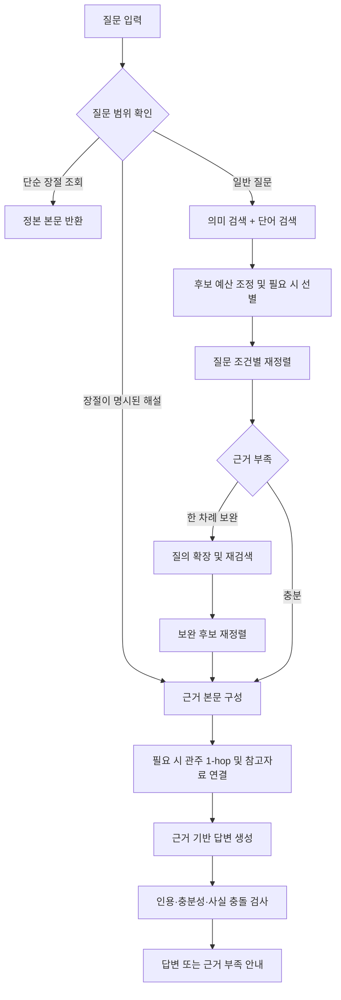

# BibleOn RAG

성경에 관한 자연어 질문에서 관련 본문을 찾고, 확인한 근거를 바탕으로 답변하는 RAG 시스템이다. 성경 구절이 명시된 질문과 인물·사건을 간접적으로 설명한 질문을 구분해 처리한다. 검색부터 답변 검증까지의 흐름은 LangGraph로 구성했다.

## 처리 흐름



질문이 모호하거나 보완 검색 후에도 근거가 부족하면 답변 생성을 생략할 수 있다. 생성 후 발견한 인용 오류나 지정된 사실 충돌에는 제한된 보정을 적용한다. 같은 실패를 무한히 반복하거나 다른 모델로 자동 전환하지 않는다.

## 핵심 구현

| 구성 | 동작 | 주요 파일 |
|---|---|---|
| 청킹 | 새번역 소제목의 절 좌표와 장 경계를 기준으로 개역한글 본문을 분할한다. 긴 구간은 소제목 범위 안에서만 겹치도록 나눈다. | [rag-chunks.mjs](server/rag-chunks.mjs), [rag-heading-sections.mjs](server/rag-heading-sections.mjs) |
| 검색 | 의미 검색과 한국어 단어 검색을 결합한다. 명시된 성경 범위와 일반 인물 이름을 구별한다. | [rag-discovery.mjs](server/rag-discovery.mjs), [bible-rag.mjs](server/bible-rag.mjs) |
| 후보 전달 | 후보의 발췌문과 식별자를 압축하되, 선택한 근거의 실제 본문은 다시 확보한다. | [rag-candidate-wire.mjs](server/rag-candidate-wire.mjs), [rag-input-budget.mjs](server/rag-input-budget.mjs) |
| 재정렬 | 질문의 항목별로 후보와 근거 절을 연결한다. 없는 후보나 절을 선택하면 거부한다. | [rag-reranking.mjs](server/rag-reranking.mjs), [rag-focused-evidence.mjs](server/rag-focused-evidence.mjs) |
| 보완 검색 | REPAIR의 원리를 응용해 충족되지 않은 조건을 확인하고, 필요한 경우 한 차례 보완 검색한다. 논문 전체 구현을 그대로 재현한 것은 아니다. | [rag-adaptive-repair.mjs](server/rag-adaptive-repair.mjs) |
| 근거 확장 | 관련 관주를 1-hop까지 연결한다. 주석·사전의 설명과 성경 본문을 구별한다. | [bible-study.mjs](server/bible-study.mjs), [study-query.mjs](server/study-query.mjs) |
| 생성·검증 | 한국어 Markdown 답변을 생성하고 인용 위치, 항목별 근거 충분성, 일부 사실 충돌과 형식을 검사한다. | [rag-answer-steps.mjs](server/rag-answer-steps.mjs), [bible-sufficiency.mjs](server/bible-sufficiency.mjs), [rag-citation-repair.mjs](server/rag-citation-repair.mjs) |
| 실행 제어 | 17개 노드와 조건부 분기로 실행한다. 호출 제한과 시간 제한을 적용하며 외부 추적 전송을 차단한다. | [bible-graph.mjs](workflows/bible-graph.mjs), [rag-runtime.mjs](server/rag-runtime.mjs) |

검색 선별·재정렬·생성에는 GPT 6 Luna를 사용한다. 문서와 질문의 벡터에는 `text-embedding-v4`의 512차원 임베딩을 사용한다. 질의별 근거 충분성과 실제 답변 정답률은 서로 다르며, 위 검사가 모든 자연어 주장의 정확성을 보장하지는 않는다.

## 폴더 구성

```text
server/                 현재 RAG 알고리즘·프롬프트·모델 호출
workflows/              LangGraph 상태·노드·분기
scripts/                질문 실행·청킹·색인 생성·소스 점검
runtime-assets.json     별도 준비할 실행 데이터의 파일과 해시
.env.example            필요한 환경 설정 예시
package.json            실행 명령과 의존성
package-lock.json       의존성 버전 고정
```

## 설치와 소스 확인

Node.js 22 이상에서 실행한다.

```text
npm ci
npm run check
```

`check`는 공개 파일의 문법과 의존 관계를 검사한다. 원문·색인이 없는 상태에서도 실행되며, 답변 성능을 측정하거나 외부 API를 호출하지 않는다.

## 실행 데이터 준비

이 저장소에는 성경 원문, 허가받은 소제목 자료, 참고자료 전문, 임베딩과 생성된 색인을 포함하지 않는다. 사용 가능한 자료를 별도로 준비해야 한다. 비공개 연구 사용 허락을 공개 재배포 허락으로 간주하지 않는다.

동일한 실행 자료의 이용 허락된 백업이 있다면 `runtime-assets.json`의 해시를 확인하며 복원할 수 있다.

```text
npm run data:restore -- "D:/authorized-data/server/data"
npm run check -- --with-data
```

직접 색인을 만들 때는 `server/data/krv.json`에 정본을, `data/private/sources/rnksv/`에 사용 허락된 소제목 원자료를 준비한다. 소제목 자료는 권별 JSON이며 `book.id`, `chapters[].chapter`, `verses[].verse`, `segments[].type`이 필요하다. 구체적인 좌표 검사는 `server/rag-heading-sections.mjs`에 구현했다. 소제목의 문구와 새번역 본문을 개역한글 검색 색인에 섞지 않는다.

```text
npm run data:pack
npm run rag:headings
npm run rag:index
```

색인 생성의 기본 실행은 캐시와 필요한 임베딩 수를 확인한다. 새 임베딩을 실제로 생성하려면 `.env.local`에 키를 설정한 뒤 `npm run rag:index -- --live`를 실행한다. 이 단계에는 API 비용이 발생할 수 있다. 관주·주석·사전 실행 자료는 별도로 준비해야 하며, 위 명령이 다운로드하지 않는다.

## 질문 실행

`.env.example`을 `.env.local`로 복사하고 필요한 키를 입력한다. 실제 키는 Git에 올리지 않는다.

```text
npm run ask -- --live "말씀을 듣다가 창에서 떨어진 사람은 누구인가요?"
```

결과에는 답변, 근거 구절, 호출량 등이 JSON으로 출력된다. 모델과 임베딩 호출에는 비용이 발생할 수 있다. API 키와 성경 전체 데이터는 실행 컨텍스트에 보관하고, 그래프 상태에는 선택한 근거와 중간 결과를 전달한다. 영구 체크포인트와 외부 추적 전송은 사용하지 않는다.

## 공개 범위

현재 구현과 실행에 필요한 파일만 `.gitignore`에서 개별 허용한다. 테스트·평가 질문·과거 모델 비교·실험 기록·이전 실행 경로·원문·생성 데이터·API 키는 공개 대상이 아니다. 공개 코드만으로 과거 실험 결과까지 재현된다고 주장하지 않는다.
