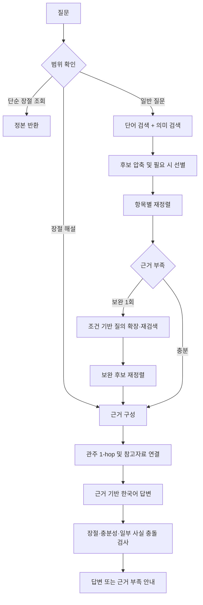

# BibleOn RAG

성경에 관한 자연어 질문에서 관련 본문을 찾고, 확인한 근거로 답변하는 Python RAG 시스템이다. 장절이 명시된 질문과 인물·사건을 간접적으로 설명한 질문을 구분한다. 검색부터 답변 검증까지 17개 단계의 실제 LangGraph로 실행한다.

## 처리 흐름



질문의 항목마다 근거를 따로 배정한다. 일부 세부 사항만 확인할 수 없으면 핵심 답변은 유지하고 그 부분의 한계를 밝힌다. 핵심 근거가 없으면 생성 단계를 생략할 수 있다. 실패 후 다른 모델로 자동 전환하거나 같은 보정을 반복하지 않는다.

## 핵심 구현

| 구성 | 동작 | 파일 |
|---|---|---|
| 청킹 | 새번역 소제목의 절 좌표와 장 경계로 개역한글을 나눈다. 긴 구간은 같은 소제목 안에서만 최대 24절·1,800자, 3절 겹침으로 분할한다. | [passages.py](bibleon_rag/passages.py) |
| 검색 | 단어·접두어·문자 이중항 검색과 512차원 벡터 검색, 본문 구간·현대어 표현·참고자료 검색을 합친다. 명시한 성경 범위와 일반 인명을 구분한다. | [retrieval.py](bibleon_rag/retrieval.py), [discovery.py](bibleon_rag/discovery.py) |
| 후보 압축 | 후보 식별자와 발췌문을 압축해 전달한다. 선택 후에는 정본에서 실제 근거를 다시 확보한다. | [selection.py](bibleon_rag/selection.py) |
| 재정렬·보완 | 질문 조건별 근거 절을 선택한다. REPAIR의 원리를 응용해 부족한 조건을 한 차례 재검색한다. 논문 전체를 그대로 재현한 구현은 아니다. | [selection_steps.py](bibleon_rag/selection_steps.py), [repair.py](bibleon_rag/repair.py) |
| 근거 확장 | 관주를 1-hop까지 연결하며 주석·사전과 성경 본문을 구별한다. | [study.py](bibleon_rag/study.py) |
| 생성·검증 | 두괄식·소제목·강조·문단·구분선을 사용하는 한국어 Markdown 답변을 생성한다. 실제 인용 문구, 장절, 항목별 충분성, 일부 사실 충돌과 문장 완결성을 검사한다. | [answer_steps.py](bibleon_rag/answer_steps.py), [sufficiency.py](bibleon_rag/sufficiency.py), [validation.py](bibleon_rag/validation.py) |
| 실행 제어 | 17개 노드와 조건부 분기, 요청별 상태 분리, 취소·시간·토큰 제한을 적용한다. | [graph.py](bibleon_rag/graph.py), [runtime.py](bibleon_rag/runtime.py) |
| 데이터 준비 | 허가된 로컬 원문·소제목 좌표를 읽고, 캐시를 재사용해 검색 색인을 만든다. | [preparation.py](bibleon_rag/preparation.py) |

선별·재정렬·생성·보정은 `gpt-6-luna`의 낮은 추론 설정을 사용한다. 벡터는 `text-embedding-v4` 512차원이다. 새 모델로 자동 대체하지 않는다. 현재 자산은 2,815개 소제목·장 구간에서 나눈 3,048개 청크를 담고 있다.

후보 합집합은 최대 420개, 첫 재정렬 이전 풀은 질문에 따라 128/160개다. 입력이 길면 최대 24개로 선별한다. 최종 선택은 최대 6개 청크이며, 실제 답변 근거는 6,000자·96절 한도 안에서 구성한다. 관주와 참고자료는 별도 제한으로 덧붙인다. 보완 검색은 한 번이며, 추가 후보 48개와 확장 질의 2개를 넘지 않는다.

## 설치

Python 3.11 이상이 필요하며 Windows의 Python 3.13에서 검증했다. 다음은 PowerShell 기준이다. Node.js나 상위 프로젝트는 필요하지 않다.

```powershell
python -m venv .venv
.venv\Scripts\python.exe -m pip install -r requirements.lock
.venv\Scripts\python.exe -m pip install --no-deps -e .
.venv\Scripts\python.exe -m bibleon_rag check
git config core.hooksPath .githooks
```

macOS/Linux에서는 `.venv\Scripts\python.exe` 대신 `.venv/bin/python`을 사용한다. 이 프로젝트는 실행 자료를 저장소 폴더에서 찾으므로 editable 설치(`-e .`)로 사용한다. `requirements.lock`은 직접·간접 실행 의존성의 버전을 고정한다.

`check`는 공개 소스의 문법·의존 관계와 실제 그래프 구성을 검사한다. 원문이나 키 없이 실행할 수 있으며 API를 호출하지 않는다. 그래프 도식은 다음 명령으로 출력한다.

```powershell
.venv\Scripts\python.exe -m bibleon_rag graph
```

## 실행 자료 준비

저장소에는 성경 원문, 새번역 소제목 원자료, 주석·사전 전문, 벡터, 생성 색인을 포함하지 않는다. 이용 허락된 자료가 별도로 필요하다. 연구용 사용 허락을 공개 재배포나 외부 모델 전송 허락으로 간주하지 않는다.

동일한 실행 자료의 허가된 백업이 있다면 다음과 같이 복원한다. `python-runtime-assets.json`의 6개 파일 해시를 모두 확인한 뒤 복사한다. 기존 파일의 내용이 다르면 덮어쓰지 않는다.

```powershell
.venv\Scripts\python.exe -m bibleon_rag data-restore "D:/authorized-data/runtime"
.venv\Scripts\python.exe -m bibleon_rag check --with-data
```

실행 자료는 `data/runtime/`의 `corpus.json.gz`, `headings.json`, `vectors.i8`, `index.json`, `lexical.json.gz`, `study.json.gz`이다. 모두 JSON·gzip·정수 배열이며, 실행 가능한 코드나 pickle을 데이터로 읽지 않는다. 파일·청크·좌표·색인 해시를 대조해 불일치를 감지한다.

새 자료로 만들려면 아래 순서를 사용한다. 정본 JSON은 `{bookId: {name, chapters: {장: {절: 본문}}}}` 형태다. 소제목 자료는 권별 JSON이며 `book.id`, `chapters[].chapter`, `verses[].verse`, `segments[].type`을 사용한다. 소제목 좌표를 개역한글에 대응시키되 새번역 본문과 소제목 문구를 검색 본문에 혼합하지 않는다. 세부 검사는 `passages.py`에서 수행한다.

```powershell
.venv\Scripts\python.exe -m bibleon_rag data-pack "D:/authorized-data/krv.json"
.venv\Scripts\python.exe -m bibleon_rag build-headings "D:/authorized-data/rnksv"
.venv\Scripts\python.exe -m bibleon_rag build-index
```

`build-index`는 기존 문서 임베딩 캐시를 재사용한다. 빠진 벡터가 있으면 필요한 수량만 알리고 중단한다. 새 임베딩은 키를 설정한 뒤 `build-index --live`로 명시적으로 허용해야 하며 API 비용이 발생할 수 있다. 관주·참고자료는 별도로 준비하며 위 명령은 자료를 다운로드하지 않는다. 6개 실행 파일이 모두 준비되면 해시 목록을 갱신한다.

## 질문 실행

단순 장절 조회는 키나 외부 API 없이 실행한다.

```powershell
.venv\Scripts\python.exe -m bibleon_rag lookup "마태복음 1:5"
```

모델 답변은 `.env.example`을 `.env.local`로 복사한 뒤 이 저장소용 키를 입력하고 실행한다. 키는 상위 폴더나 시스템 환경에서 자동으로 가져오지 않는다.

```powershell
.venv\Scripts\python.exe -m bibleon_rag ask --live "말씀을 듣다가 창에서 떨어진 사람은 누구인가요?"
```

답변·근거 구절·호출량을 JSON으로 출력한다. `--live`는 유료 API 호출을 허용하는 옵션이다. 질문 임베딩 호출이 실패하면 단어 검색으로 제한해 계속하지만, 답변 모델 오류에는 재시도나 다른 모델로의 대체를 하지 않는다.

코드에서 직접 사용할 때는 `await run_bible_graph(...)`를 호출한다. `corpus`, `retriever`, `study_index`, `env`를 외부 실행 문맥으로 전달하고, 대화 이력은 `history`, 검증된 이전 근거는 `previous_evidence`로 넘긴다. 요청 취소에는 `asyncio.Event`를 전달할 수 있다. 반환 필드는 `text`, `citations`, `contextPassages`, `usage` 등의 기존 JSON 계약을 유지한다.

## 실행 제한과 검증 범위

- 요청 시간 110초, 모델 호출당 50초, 임베딩 호출당 12초를 제한한다.
- 성공한 모델 호출은 요청당 최대 6회, 전체 추론 사용량은 최대 3,000토큰이다. 답변 가시 출력은 3,000토큰 한도를 유지한다. 제공자의 사용량이 없거나 모델이 다르면 결과를 거부한다.
- 자동 재시도, 체크포인트 저장, 외부 추적 전송을 사용하지 않는다. 외부 추적 설정이 감지되면 실행을 중단한다.
- JSON 스키마, 근거 소속, 실제 인용 문자열, 장절, 한국어 비중, 문장 완결성을 검사한다. 사실 충돌 검사는 일부 명시적 패턴에 한정된다. 모든 자연어 주장의 정확성을 보장하지 않는다.

## 공개 범위

`.gitignore`는 현재 Python 구현·실행 설정만 개별 허용한다. 테스트, 평가 질문, 모델 비교, 실험 기록, 이전 JavaScript 구현, 원문, 벡터, API 키는 제외한다. 과거 실험 결과까지 공개 코드만으로 재현된다는 뜻은 아니다.

```powershell
.venv\Scripts\python.exe -m bibleon_rag check-git
```

커밋 훅은 추가되는 경로와 비밀키 패턴을 점검한다. 저작권 허가나 모든 비밀정보의 부재를 대신 보장하는 기능은 아니다.
